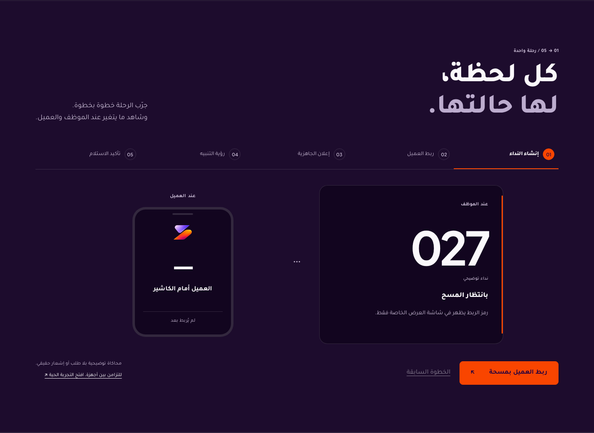
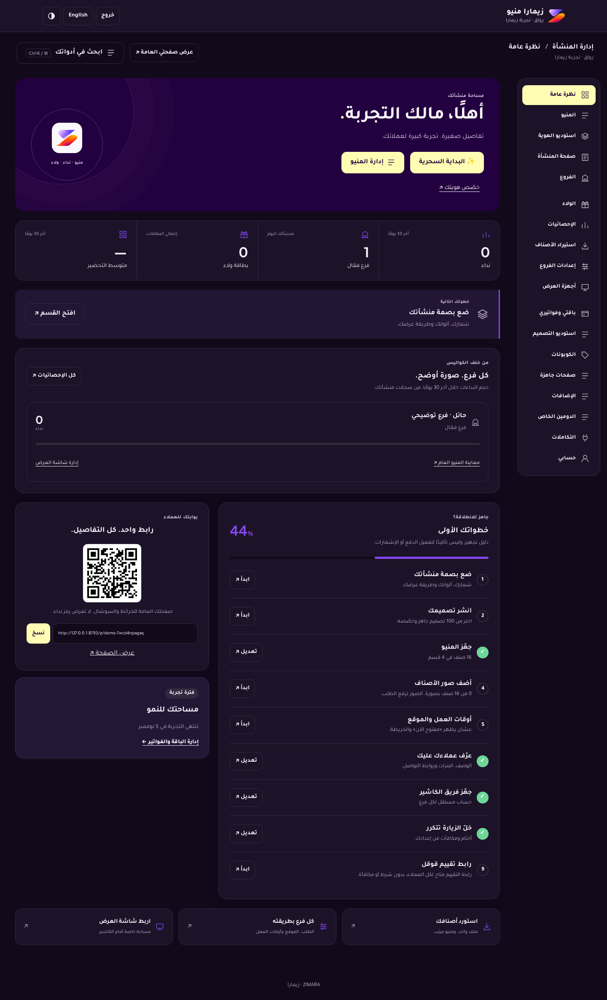
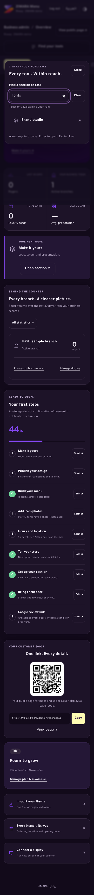

# Connected visit and subscriber workspace

Base: `433dd214727675cb217af5dc1afdf9f5947ed7bd` (latest main, PR #24). This slice extends the current product; it does not replace the newer design, ordering, loyalty, passkey or realtime work.

## Result

- A five-step marketing illustration shows the staff and guest perspectives: waiting for a scan, linked, ready, acknowledged, collected. Previous/reset work without creating orders, sending notifications or requesting device permissions. `/demo` remains the real synchronised demo.
- A role-scoped workspace finder exposes the existing allowed sections, with Arabic normalization, task keywords, clear/no-results, keyboard navigation, Escape and focus restoration. Ctrl/Cmd+K does not intercept typing in editable fields. Selection goes through the existing unsaved-changes guard.
- The overview recommends the next incomplete setup task and shows each branch's actual 30-day pager count, public-menu preview and display-management destination. The guide explicitly distinguishes setup progress from live provider activation.
- Failed section loads preserve the shell, expose an accessible error and retry the original data load. Loading/error/retry titles and busy states remain meaningful.
- Marketing copy no longer promises that an adapter automatically activates a provider. The payment-method strip says activation is in progress. Google review setup is described as available to every guest, without a reward or satisfaction condition.

Brand assets, runtime palette/font owners, form validation, save/confirmation behavior, public/private routes, billing, permissions, email configuration and database schema remain owned by the existing implementation. See `DESIGN.md` and `UX-CONTRACT.md` for the maintained visual/behavior contracts.

## Verification

Local environment: current source, Node 24, Wrangler 4.156, a **new local synthetic D1 database**, no real provider secrets. Commands:

| Check | Result |
| --- | --- |
| `npm test` | 111 passed, 0 failed |
| `npm run test:e2e -- http://127.0.0.1:8793 output/refresh/connected` | Separate cashier/display/guest contexts; QR disappearance, stale conflict, ready/seen/collection/rating, reconnect, loyalty and landing all passed |
| `npm run test:onboarding -- http://127.0.0.1:8793 output/refresh/onboarding` | Signup, cashier setup, CSV import, profile, billing/integration states, public cart and acceptance passed |
| `npm run test:workspace -- http://127.0.0.1:8793 output/refresh/workspace` | All 18 owner destinations, uploads, persisted settings, profile/menu, locales and responsive views passed |
| `npm run test:resilience -- http://127.0.0.1:8793 output/refresh/resilience` | Validation, preserved edits, duplicate protection, branch access, polling/conflict recovery passed |
| `npm run test:brand-workspace -- http://127.0.0.1:8793 output/refresh/brand-workspace` | New illustration, finder, unsaved guard, API failure/retry, owner/cashier scope, rapid reopen, 360–1440px, Arabic/English, themes and reduced motion passed |
| `npm run build` / `npm run build:preview` | Worker dry run and embedded preview packaging passed |

The new browser suite is included in the existing CI browser job. Screenshots were visually inspected. No test emails or real payments were sent. Real-device Push/Wallet delivery, full WCAG conformance, production performance and legal/security certification are not established by these checks.

### Static audit qualification

The strict premium auditor was run on both an unmodified archive of the base SHA and this source. Both report the **same 60 existing findings**, with **zero added findings** when compared by file/rule/message. Fifty-eight are `actionless-button` heuristics: this auditor sees literal markup but cannot trace the project's separate JS event bindings; relevant controls are exercised by the browser suites above. One pre-existing design-studio form lacks an explicit `novalidate` attribute (the app currently normalizes it at runtime), and one ticket textarea warning does not detect the global `textarea { resize: none; }` owner. This is not recorded as a clean whole-project static audit, and unrelated screens were not rewritten to silence it.

Local Graphify AST extraction was used to trace the current landing/workspace dependencies. Its scoped updated graph is retained in ignored test output, outside public assets; no API key or semantic model was required.

## Installation prerequisite

The new uploaded ZIP has 36 skill instructions and 412 files. All match the already installed copies (normalizing text line endings). All 13 requested source repositories exist; registered skill instruction integrity checks found no missing or changed files. Machine-readable verification: `/workspace/toolkit/VERIFICATION-20261105.json`; readiness and external-provider limitations: `/workspace/toolkit/INSTALLATION.md`. This verifies workspace installation, not automatic activation of every MCP service or account in the chat.

## Review deployment and rollback

Use the existing main/review pipeline only, after CI succeeds: Worker `zimara-menu-review-20261031`, its separate review D1, existing secrets and bindings. The last inspected review deployment before this change was `0a72eb23-37af-4c15-949f-0faba2cead7a`, version `28cf2cab-9e86-4710-917d-5850b6f65096` (base SHA above). Restore that version and its asset set to revert the UI; no schema rollback is needed. This slice adds no migration.

Do not change the institutional Worker, production database, owner/MFA, secrets or DNS. The existing review URL is a review environment, not a commercial launch. Billing/provider/Wallet activation remains a separate tested operation with the account owner's credentials and approved business details.

## Screenshots

