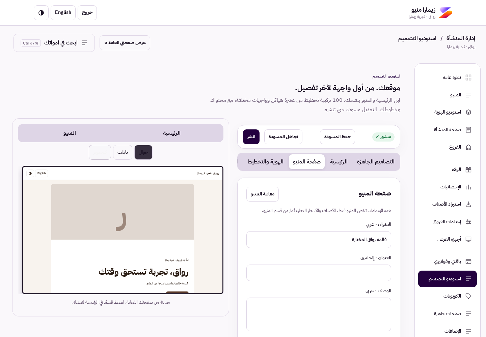

# Merchant site builder

This change addresses the subscriber's own website, rather than only ZIMARA marketing or navigation.

- Homepage: up to 24 typed sections; add, remove, duplicate, reorder, show/hide, bilingual copy, uploaded hero/image media, gallery, FAQ, actions, branch/menu/contact/hours and live featured products. Merchant logo/name replace the ZIMARA masthead on merchant pages.
- Menu page: independent title, description, announcement/link, search, price and loyalty visibility, cart placement, structural frame/hero/navigation, images, typography and density. Product ordering and actual prices continue through existing server pricing.
- Catalogue: 100 unique bounded structural combinations across ten frames and ten hero compositions, using compatible preset IDs. This is not a claim of 100 individually hand-designed sites. Ten full rendered menu frames were checked for different geometry and mobile overflow.
- Typography: IBM Plex Sans Arabic, Readex Pro and Alexandria self-hosted WOFF2 with OFL licenses; independent heading size/face and reading spacing; uploaded merchant font can be selected. Other existing font choices remain compatible.
- Private drafts, live homepage/menu preview, phone/tablet/desktop widths, publish, existing versions/schedules. Theme changes preserve homepage/menu copy. Serialized saves and revision checks reject stale writes; a failed save prevents publish.
- Branch-specific cashier capabilities: pagers, call/repeat/collect/cancel, loyalty lookup/stamp/redeem, incoming orders, availability, waitlist and displays. Server enforcement applies to already authenticated sessions. Owner boundaries and audit logging remain mandatory. Existing display-device bearer links are independent device grants; revoke them separately through display management.

Validation: 114 unit/integration tests passed. Existing design, workspace and connected cashier/display/guest Playwright suites passed. New tenant-studio browser suite builds a homepage and FAQ, independently customizes menu, verifies private draft then publication, exercises ten frames at desktop/mobile widths and saves cashier permissions. Worker dry-run and embedded preview build passed. New suite is included in CI. Screenshots below use synthetic demo data.

The strict static premium audit reports 63 heuristic findings (principally JS-bound buttons not traced by the HTML scanner); this is not reported as a clean whole-project audit. Shared runtime textarea rules and actual browser flows remain the evidence for this slice. No full WCAG, provider activation or security guarantee is claimed.

Apply additive `0023_tenant_studio.sql` only to the isolated review D1 through the existing pipeline. It adds design revisions and branch permission storage; no reset/seed/owner/secret/DNS changes. Roll back code to previous version; retain the additive schema. Designs with new bounded fields must be preserved for forward deployment, not rewritten with an older editor. Keep commercial/provider activation separate.

Open `/demo?view=studio`, create a room, then choose the owner to enter the new studio directly. No real email or payment is needed.

