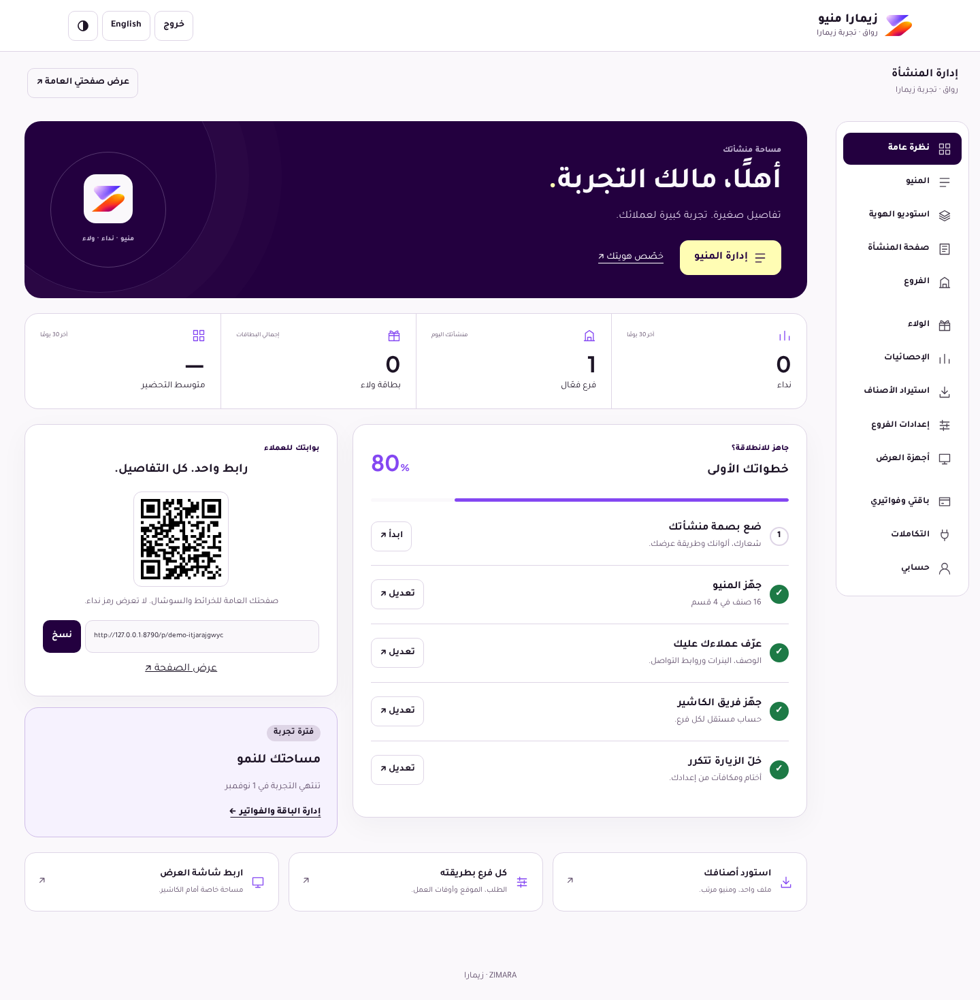
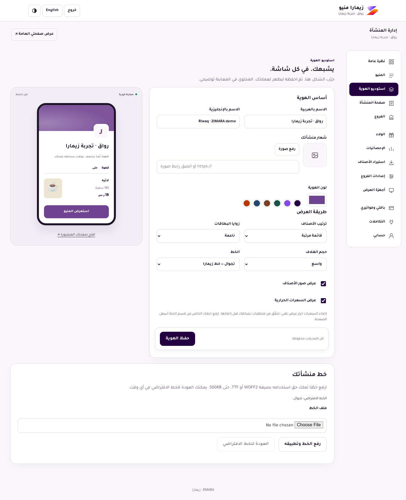
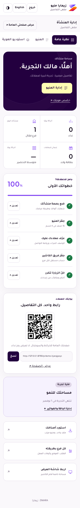

# Subscriber workspace and identity studio

Base: `main` at `1312b947c4b1833c8ced162572b9293b16caba57` (PR #17). This change builds on the current menu, D1 uploads, Rewaa, billing profile and guarded Simple Fatoora code. The older unfinished local launch branch was retained separately and was not merged over this source.

The owner now lands on a ZIMARA workspace with actual branch/menu/loyalty/subscription data, setup progress, public-page sharing and quick actions. Thirteen sections remain reachable by direct hash links and keyboard navigation. The platform keeps ZIMARA's official symbol; tenant branding belongs to the studio and customer pages.

## Working controls

- Identity studio: bilingual names, logo upload, colour presets, live illustrative preview, menu list/cards, corners, cover height, item images/calories and font choice.
- Custom font upload (WOFF2/TTF, 500KB): validates actual bytes and ownership through the existing asset endpoint; apply or restore the default without losing other choices.
- Business page: up to twelve social links and eight banners, bilingual alternative text and banner destinations, row removal/reordering, section visibility and order. No edits are published until Save.
- Branch settings: ordering switch, address/maps, waiting game and seven-day opening hours. Overnight hours and closed days are supported in Riyadh time.
- Public profile/menu consume persisted choices, show the banner gallery, preserve menu/cart behaviour and never expose a pager QR.
- Integration cards distinguish configuration from verified delivery. Existing Resend configuration is preserved; a configured key alone is not labelled a successful delivery test.

## Validation

Local isolated database, synthetic users and rooms, no Resend secret and no external payment/invoice calls:

- `npm test`: 73 passed, including identity validation, partial update preservation, tenant isolation, branch hours and existing mail/payment tests using mocks.
- `npm run test:workspace -- http://127.0.0.1:8790 output/workspace`: nine acceptance groups passed; all thirteen sections loaded; actual image/font upload, persisted edits, reload, public rendering, 360–1440px widths, English, dark mode and reduced motion; no browser JavaScript errors.
- `npm run test:e2e -- http://127.0.0.1:8790 output/workspace/journey`: fourteen connected-journey checks passed in separate browser contexts, including QR disappearance, stale cashier conflict, ready/seen/pickup/rating, reconnect and loyalty redemption.
- `npm run test:onboarding -- http://127.0.0.1:8790 output/workspace/onboarding`: actual signup, CSV import, profile, branch settings, subscription/integration pages and order acceptance passed; no browser JavaScript errors.
- Worker dry-run and embedded preview build passed. CI also runs the new workspace browser suite.

These checks do not establish real-device push/sound delivery, payment settlement with a live provider, legal certification, full WCAG conformance or a security guarantee. Resend sending is confirmed by the owner; this change deliberately sends no test messages to customers. Platform-wide super-admin expansion and unrelated unfinished launch work are outside this dashboard change.

## Screenshots

Synthetic demonstration data only:

## Migration and rollback

Apply `0013_workspace_identity.sql` to the isolated review database before deploying code. It adds only `org_profiles.theme_json`, defaulting to `{}`. Existing colours, names, fonts, profiles and records remain intact. Previously uploaded fonts retain their custom-font default.

Record the previous Worker deployment/version and deploy the tested commit. Preserve `AUTH_SECRET`, `RESEND_API_KEY`, `MAIL_FROM`, `PUBLIC_BASE_URL`, VAT and other existing settings. No DNS, production database, institutional Worker or credentials are changed. To revert, restore the prior Worker version with its original asset binding/settings; leave the extra column in place. Never drop/reset data to roll back the interface.

The review environment is not a commercial launch. Moyasar/Rewaa account credentials, invoice-provider runtime credentials, Apple/Google Wallet implementation/credentials and legal business details still require the separately documented activation work. No activation is implied by the visual redesign.
